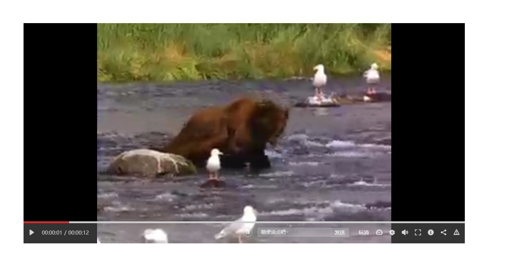

# xqplayer

一个简单好用的 HTML5 视频播放器 —— 同时提供 UMD / ESM / Vue 2、3 组件，支持 HLS、FLV 与弹幕。

[English](./README.md)

> **从 0.0.x 升级？** 包的根入口现在导出的是播放器本体，Vue 用户请改从 `xqplayer/vue` 引入。
> 详见下方[从 0.0.x 迁移](#从-00x-迁移)。

## 安装

```sh
npm i xqplayer
```

## 三种引入方式

### 1. UMD（`<script>` 直接引入）

```html
<link rel="stylesheet" href="https://unpkg.com/xqplayer/lib/css/xqplayer.min.css">
<div id="myPlayer"></div>

<script src="https://unpkg.com/xqplayer/lib/js/xqplayer.min.js"></script>
<script>
    var myVideo = new XQVideoPlayer({
        el: '#myPlayer',
        url: './data/movie.mp4',
    });
</script>
```

### 2. ESM（打包器）

```js
import XQVideoPlayer from 'xqplayer';
import 'xqplayer/css/xqplayer.css';

const player = new XQVideoPlayer({ el: '#myPlayer', url: './data/movie.mp4' });
```

也支持具名导出：

```js
import { XQVideoPlayer, VERSION } from 'xqplayer';
```

### 3. Vue 2 / Vue 3

```js
// Vue 2
import Vue from 'vue';
import xqVideo from 'xqplayer/vue';
Vue.use(xqVideo);

// Vue 3
import { createApp } from 'vue';
import xqVideo from 'xqplayer/vue';
createApp(App).use(xqVideo).mount('#app');
```

```html
<xq-video
    :url="video.url"
    :poster="video.poster"
    :mode="video.mode"
    :width="720"
    :height="405"
    :barrages="video.barrages"
    :shareTitle="video.name"
    @clickBarrage="someThings"
    @saveBarrages="sendBarrage"
></xq-video>
```

组件本体是 `.vue` 单文件，因此宿主需要有 `vue-loader` 或 `@vitejs/plugin-vue`。

## 参数

| 名称 | 类型 | 默认值 | 必填 | 说明 |
| --- | --- | --- | --- | --- |
| `el` | `string \| HTMLElement` | — | **是** | 容器选择器或元素 |
| `url` | `string` | — | **是** | 视频地址（mp4 / m3u8 / flv） |
| `poster` | `string` | `''` | 否 | 封面图 |
| `barrages` | `Array` | `[]` | 否 | 初始弹幕列表 |
| `mode` | `'mp4' \| 'm3u8' \| 'flv'` | `'mp4'` | 否 | 播放类型 |
| `width` | `number \| string` | `1200` | 否 | 宽度 |
| `height` | `number \| string` | `600` | 否 | 高度 |
| `title` | `string` | `''` | 否 | 分享标题，缺省用 `document.title` |
| `share` | `Function` | `null` | 否 | 该实例使用的 xqshare 构造器 |

只有 `el` 和 `url` 是必填，`poster` 自 0.1.0 起真正可选。

控制条会按 `width` 自己调整：小于 680px 收起清晰度与倍速菜单，小于 520px 再收起弹幕输入框，
保证剩下的按钮不换行、不互相覆盖。样式里的 `box-sizing` 与按钮外观重置都限定在播放器内部，
不会污染宿主页面。

## 可选的外部依赖

播放器产物本身零运行时依赖，这些库**不会被打进 `xqplayer`**。播放器在运行时探测它们，
缺哪个就只降级哪个能力（HLS/FLV 进错误态，分享给一句提示），不会抛 ReferenceError。

| 能力 | 需要的库 | 探测方式 |
| --- | --- | --- |
| m3u8 / HLS | [hls.js](https://github.com/video-dev/hls.js) | `window.Hls` |
| flv | [flv.js](https://github.com/bilibili/flv.js) | `window.flvjs` |
| 分享弹层 | [`xqshare`](https://www.npmjs.com/package/xqshare) | `window.XqShare` 或主动注入 |

```html
<script src="https://cdnjs.cloudflare.com/ajax/libs/hls.js/1.0.8/hls.min.js"></script>
<script src="https://cdnjs.cloudflare.com/ajax/libs/flv.js/1.6.1/flv.min.js"></script>
```

### 让分享按钮真正可用

`xqshare` 已是本包的声明式依赖，`npm i xqplayer` 会一并装上，但播放器不会替你注入它。
按你的场景三选一：

```html
<!-- 1. 直接 <script>：xqshare 有 UMD 产物，样式要单独引 -->
<link rel="stylesheet" href="./node_modules/xqshare/lib/css/xqshare.min.css">
<script src="./node_modules/xqshare/lib/js/xqshare.min.js"></script>
```

```js
// 2. 打包器：注册一次构造器
import XQShare from 'xqshare';
import 'xqshare/css/xqshare.min.css';
import XQVideoPlayer from 'xqplayer';

XQVideoPlayer.useShare(XQShare);
// 也可以只给某个实例：new XQVideoPlayer({ ..., share: XQShare })
```

```vue
<!-- 3. Vue：直接传组件，不需要任何全局变量 -->
<script>
import { component as XQShare } from 'xqshare/vue';
export default { data: () => ({ resolveShare: () => XQShare }) };
</script>

<xq-video url="./movie.mp4" :share-resolver="resolveShare" />
```

三条都不做时分享图标也不会报错，只是弹一句「分享组件未加载」并在控制台 warn。

## 实例方法

```js
const player = new XQVideoPlayer({ el: '#app', url: './movie.mp4' });

player.playVideo();          // 播放 / 暂停
player.setVolume(0.5);       // 0 - 1
player.setSpeed(1.5);
player.setStatus('提示文案');  // 短暂提示
player.reload();             // 重新加载当前源
player.loadVideo({ url: './another.mp4' });
player.secondToTime(3661);   // '01:01:01'
player.shareVideo();         // 打开分享弹层，返回 xqshare 实例（不可用时为 null）
player.destroy();            // 移除 DOM、摘掉监听、销毁 hls/flv 与分享实例
```

同页面可以放多个实例，互不影响：每个播放器只从自己的根节点里找节点（没有写死的 id），
不会出现「第二个播放器的按钮控制了第一个」这种情况。

`destroy()` 会彻底收尾：媒体监听、滚动监听、hls/flv 实例全部释放。单页应用里在移除容器前请务必调用。

## 从 0.0.x 迁移

- `require('xqplayer')` 原先返回 Vue 插件（且会因为 `.vue` 引入直接报错），现在返回播放器本体，
  Vue 用户请改用 `xqplayer/vue`。
- `poster` 以前不传会抛 "poster is must!"，现在真正可选。
- 不再抢占 `window.onscroll`，不再整体改写 `document.body.className`。
- 弹幕内容会被转义，不再作为原始 HTML 插入（避免 XSS）。
- HLS / FLV / 分享库改为运行时探测，缺失不再中断实例初始化。
- `secondToTime(10)` 修正为 `00:00:10`（旧实现输出 `010`）；拖拽的 clamp 与坐标参考系也已修正。

## 给 AI 助手

发布包里带了给 AI 用的元数据，在 `package.json` 里声明，并一起打进 npm 包：

- `llms` → `llms.txt`：精简的 API 说明 —— 导出面、参数与真实默认值、实例方法、
  可选依赖的降级行为、接入限制。
- `agents` → `skills/xqplayer-integration/SKILL.md`：接入指南 —— 先选哪个入口、接线顺序、
  销毁时机、怎么自检。精确的表格在 `skills/xqplayer-integration/references/api.md`，
  可直接运行的示例在 `references/examples.md`。

两个文件都能直接从 `node_modules/xqplayer/` 读到，不依赖联网。

## 开发

```sh
npm run build          # 由 src/ 重新生成 lib/ 下的产物
npm run check          # 产物与源码不一致时报错退出
npm test               # node:test 单元测试（72 条断言）
npm run test:harness   # 基于桩 DOM 的行为回归
npm run serve          # 启动测试页 http://localhost:5173
npm run release patch  # 升版本 + 构建 + 测试 + 打 tag + 推送（不使用强推）
```

`lib/` 下是由 `src/` 生成并提交的构建产物，请不要手工改动 —— `npm run check` 会拦下来，
CI 里跑同一条命令即可。

测试页会直接在页面上输出 PASS / FAIL / SKIP：

| 页面 | 验证内容 |
| --- | --- |
| `test/browser.html` | UMD 导出、多实例隔离、XSS 转义、destroy |
| `test/esm.html` | default 与具名导出、缺失 hls.js 时的降级 |
| `test/vue2.html` | Vue 2 真实挂载、checkbox id 唯一、teardown |
| `test/vue3.html` | Vue 3 真实挂载、unmount 清理 |

两个 Vue 页的运行时从 CDN 加载，离线环境下会显示 **SKIP** 而不是 FAIL。

## 预览



## 浏览器支持

支持 ES2019 的浏览器：Chrome ≥ 64、Edge ≥ 79、Firefox ≥ 62、Safari ≥ 12。
拖拽使用 Pointer Events，不需要额外的触屏兼容层。

## 反馈

[提交问题](https://github.com/gitguanqi/xqplayer/issues/new)

## 作者

[@gitguanqi](https://github.com/gitguanqi)
